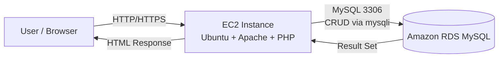
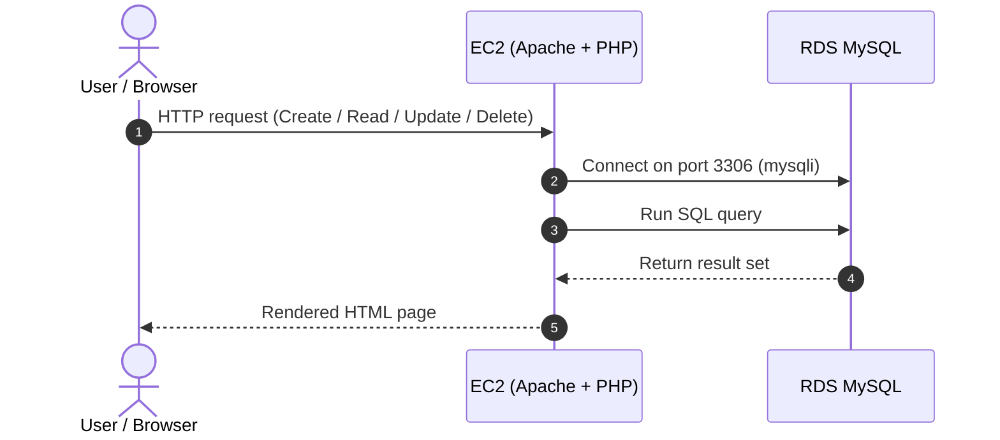

# PHP/MySQL 2-Tier CRUD Application

A 2-tier web application with create, read, update and delete operations for an `items` table. The web tier runs on AWS EC2 (Ubuntu + Apache + PHP) and the data tier runs on Amazon RDS MySQL.

## Architecture





## Setup

### 1. Create the database table

Connect to RDS with MySQL Client or MySQL Workbench, then run `schema.sql`.

### 2. Configure Apache environment variables

Add the following to your Apache virtual host (for example `/etc/apache2/sites-available/000-default.conf`), replacing the placeholders:

```apache
SetEnv DB_HOST "<your-rds-endpoint>"
SetEnv DB_PORT "3306"
SetEnv DB_USER "<your-db-user>"
SetEnv DB_PASSWORD "<your-db-password>"
SetEnv DB_NAME "<your-db-name>"
```

Restart Apache:

```bash
sudo systemctl restart apache2
```

### 3. Deploy the files

Copy these files to the Apache web root (`/var/www/html`):

- `index.php`
- `db.php`
- `style.css`

### 4. Network requirements

- EC2 and RDS must be in the same VPC.
- The RDS security group must allow inbound MySQL (3306) from the EC2 security group.

## Security notes

- Never commit real credentials to Git. Use environment variables (see `.env.example`).
- Keep SSH (port 22) restricted to your own IP.
- If a password was ever committed, rotate it in RDS and update the Apache configuration.
